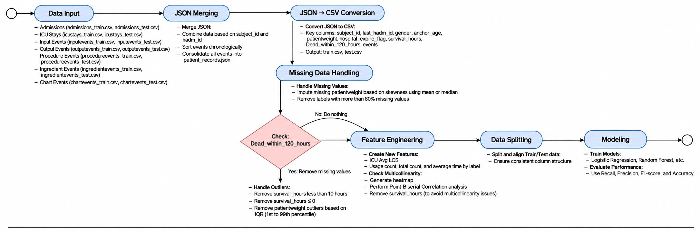
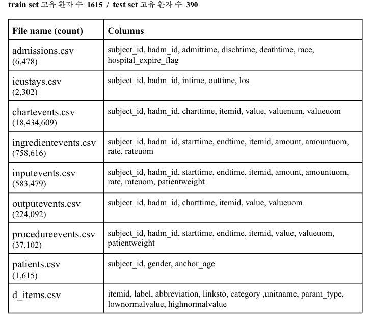
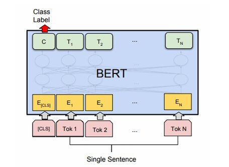
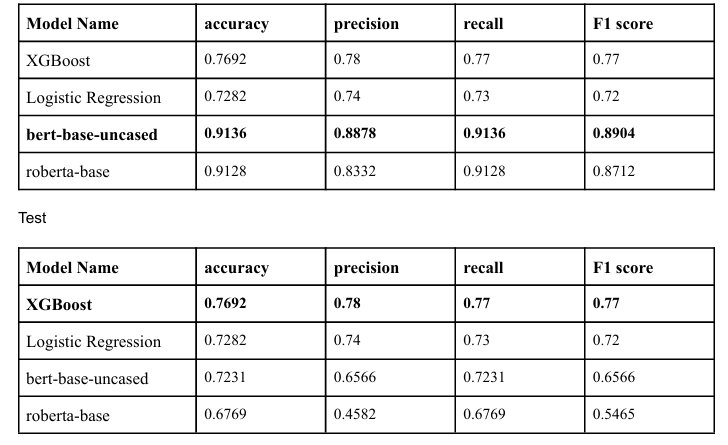
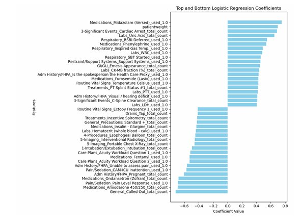
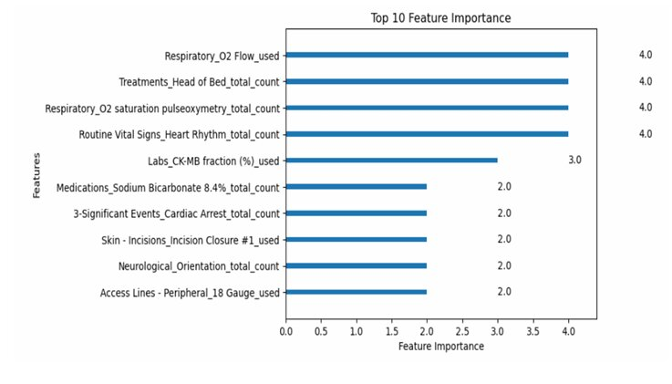

# Patient Mortality Prediction with MIMIC Data

**Predicting mortality within 120 hours of the last hospital admission using tabular clinical features and chronological event sequences.**

This project processes eight MIMIC clinical CSV tables and the `d_items` dictionary, compares **XGBoost**, **Logistic Regression**, **BERT**, and **RoBERTa**, and analyzes predictive clinical features. The final report documents **1,615 training patients and 390 test patients**.

[Portfolio (Korean)](https://app.notion.com/p/3d568564df5a8106b931ef2eb591c508) · [Portfolio (English)](https://app.notion.com/p/66068564df5a83329dc2012278107120)

## Project Overview



| Item | Description |
| --- | --- |
| Objective | Classify death within 120 hours after the last admission |
| Source | MIMIC clinical tables and `d_items.csv` |
| Training / test patients | 1,615 / 390 |
| Tabular models | XGBoost, Logistic Regression |
| Sequence models | `bert-base-uncased`, `roberta-base` |
| Evaluation | Accuracy, Precision, Recall, F1-score |

## 01. Dataset and Exploratory Analysis

Eight clinical CSVs—`admissions`, `icustays`, `chartevents`, `ingredientevents`, `inputevents`, `outputevents`, `procedureevents`, and `patients`—are joined using `subject_id` and `hadm_id`. `d_items.csv` maps item IDs to labels and categories.



The final report compares ICU length of stay: approximately **1.2 days** for patients who died within 120 hours versus **6.5 days** for those surviving beyond 120 hours. Differences in item usage between the groups also informed feature selection. These are descriptive associations, not causal conclusions.

## 02. Tabular Data Processing and Feature Engineering

1. **Data integration:** Join tables using `subject_id` / `hadm_id`; sort admission events by time; consolidate records into JSON and convert them to training and test CSV files.
2. **Feature construction:** Use `d_items` labels/categories to derive label usage, event frequency, mean event duration, and average ICU length of stay.
3. **Feature filtering:** The reports list **5,240 constructed columns**, **1,330 removed for missingness**, **420 constant columns removed**, and approximately **3,900 final features**. Direct subtraction yields **3,490**; this is an unresolved inconsistency in the source documents, not a verified final dimensionality.
4. **Target:** `Dead_within_120_hours`. `hospital_expire_flag` and `survival_hours` were excluded from tabular predictors.

| Feature | Meaning |
| --- | --- |
| `gender`, `anchor_age`, `race` | Demographic information |
| `patientweight` | Patient weight |
| `icu_avg_los` | Average ICU length of stay |
| `label_used` | Whether a clinical label was used |
| `label_total_count` | Total number of occurrences of a label |
| `label_avg_time` | Average event duration |
| `Dead_within_120_hours` | Binary outcome (target) |

### Model Selection Rationale

- **XGBoost:** Captures nonlinear relationships and interactions among tabular clinical features.
- **Logistic Regression:** Provides interpretable coefficients to examine associations between predictors and the outcome.
- **BERT and RoBERTa:** Test whether chronological clinical events, serialized as text, can provide useful contextual information for classification.

### Tabular modeling

XGBoost and Logistic Regression were compared using five-fold cross-validated grid search. The report describes a **64% training / 16% validation / 20% test** split.

| Model | Selected hyperparameters |
| --- | --- |
| XGBoost | `n_estimators=150`, `max_depth=3`, `learning_rate=0.2`, `subsample=0.8`, `colsample_bytree=1.0`, `gamma=5` |
| Logistic Regression | `C=0.01`, `max_iter=100`, `penalty=l2`, `solver=lbfgs` |

The report evaluates **324 XGBoost** and **30 Logistic Regression** parameter combinations. The XGBoost parameters above follow the detailed tuned experiment (full report pp. 34–35); the later setup summary instead lists `n_estimators=100` and `colsample_bytree=0.8`.

## 03. Clinical Event Sequence Processing

For BERT and RoBERTa, the workflow separately joins clinical events by `hadm_id` and records timestamps as `event_time` alongside `event_type`. Available `itemid`, `value`, and `amount` fields are consolidated; absent fields are set to zero in intermediate representations. Events are ordered by their start times.

Elapsed time is measured from admission. Only events with `0 <= elapsed_time < 120` are retained. For admissions containing 200 or more events, the report describes filtering for informative item IDs with differing usage between outcome groups.

| Sequence field | Description | Model role |
| --- | --- | --- |
| `hospital_expire_flag` | Sequence label modified during preprocessing for the 120-hour outcome | Target |
| `hadm_id` | Unique hospital admission ID | Record grouping |
| `elapsed_time` | Hours since admission | Chronological ordering only |
| `event_type` | Event type (e.g., `admittime`, `charttime`) | Text input |
| `itemid` | Item name mapped via `d_items` | Text input |
| `value` | Measurement / amount, default 0 when absent | Intermediate data, not final text input |

**Final sequence input:** a single sentence formed from `event_type` and the mapped item label, e.g. `admittime_Item_name dischtime_Item_name`.



The full report states that records with `elapsed_time >= 120` had their `hospital_expire_flag` changed to 0 and events outside `[0, 120)` were removed. The sequence model thus used a modified mortality label. It lists **6,478 training admissions from 1,615 patients** (all training-patient admissions) and **390 test admissions from 390 patients** (only each test patient's final admission). Training admissions were split 80:20 into train/validation. Both models used learning rate `2e-5`, batch size `16`, `10` epochs, weight decay `0.01`, maximum sequence length `512`, and F1-based checkpoint selection.

## 04. Results

### Detailed Tuned Tabular Experiments (Full Report, pp. 34–37)

| Model | Validation accuracy | Test accuracy |
| --- | ---: | ---: |
| XGBoost | 0.8296 | 0.7743 |
| Logistic Regression | 0.8359 | 0.7589 |

The detailed full-report experiments are the primary reference here. The later combined summary contains different tabular metrics; both sets are distinguished rather than merged.

### Combined Model Summary (Full Report, pp. 47–48)



### Validation

| Model | Accuracy | Precision | Recall | F1 |
| --- | ---: | ---: | ---: | ---: |
| XGBoost | 0.7692 | 0.78 | 0.77 | 0.77 |
| Logistic Regression | 0.7282 | 0.74 | 0.73 | 0.72 |
| BERT | 0.9136 | 0.8878 | 0.9136 | 0.8904 |
| RoBERTa | 0.9128 | 0.8332 | 0.9128 | 0.8712 |

### Test

| Model | Accuracy | Precision | Recall | F1 |
| --- | ---: | ---: | ---: | ---: |
| **XGBoost** | **0.7692** | **0.78** | **0.77** | **0.77** |
| Logistic Regression | 0.7282 | 0.74 | 0.73 | 0.72 |
| BERT | 0.7231 | 0.6566 | 0.7231 | 0.6566 |
| RoBERTa | 0.6769 | 0.4582 | 0.6769 | 0.5465 |

XGBoost attained the highest reported test F1 (**0.77**). BERT and RoBERTa had substantially higher validation than test performance. Data sampling and split conventions were not identical across tabular and sequence branches, so this comparison does not isolate model architecture as the sole cause of the difference.

### Key Findings

- **Model complexity did not guarantee stronger test performance:** The tabular approach recorded the highest reported F1 in this experiment.
- **Validation is not the same as generalization:** Strong Transformer validation scores did not persist on the separate test set.
- **Input representation and evaluation matter:** Numerical and temporal information was underrepresented, and admission selection and splitting differed across model families.

### Model interpretation



**Leading positive Logistic Regression coefficients in the detailed full report (p. 38):**

1. **3-Significant Events_Cardiac Arrest_total_count:** Frequency of cardiac-arrest events.
2. **Medications_Midazolam (Versed)_used_1.0:** Midazolam exposure recorded during treatment.
3. **Labs_Uric Acid_total_count:** Frequency of uric-acid tests, potentially reflecting metabolic or renal monitoring.

The existing coefficient image is retained from the summary-version analysis and differs in ranking. Coefficients show model associations rather than causal effects.



**Top four XGBoost features in the detailed full report (p. 39):**

1. **Respiratory_O2 Flow_used:** Oxygen supply status.
2. **Neurological_Orientation_total_count:** Frequency of neurological orientation observations.
3. **Pain/Sedation_Pain Present_total_count:** Frequency of recorded pain observations.
4. **Respiratory_O2 saturation pulseoxymetry_total_count:** Frequency of pulse oximetry measurements.

The retained feature-importance image comes from the summary version and shows a different ranking. Feature importance describes model reliance, not causality or effect direction.

[Detailed results and interpretation](docs/results.md)

## 05. Limitations and Future Work

### Machine Learning Models

Categorical and label-based features were constructed, but quantitative data such as medication dosage and fluid balance were not fully incorporated. Focusing on the last admission and frequent events may also have missed earlier patient history and rare clinical patterns. Future work could add normalized quantitative features and longitudinal admission records to evaluate improvements in generalization.

### Deep Learning Models

Technical and input-construction constraints meant that `elapsed_time` was used only for event ordering and `value` was not included in the final text. The 512-token limit and computational constraints prevented longer-context model experiments, while hyperparameter searches were limited. Future work could combine numerical and temporal representations and compare domain-pretrained or long-context models.

**Evaluation note:** The observation window overlaps the 120-hour outcome horizon, so earlier observation cutoffs and patient-level evaluation are needed to establish early-warning performance. The full report separately describes tuned validation/test accuracy of **0.8296 / 0.7743** for XGBoost and **0.8359 / 0.7589** for Logistic Regression. These differ from the repeated tabular values in the final combined summary, so the two source presentations are not treated as identical experiments.

## 06. Code and Documentation

| File | Description |
| --- | --- |
| [Tabular modeling](notebooks/final/tabular_modeling.ipynb) | Integration, feature engineering and tabular classification |
| [Sequence preprocessing (train)](notebooks/final/sequence_preprocessing_train.ipynb) | Training-event preparation |
| [Sequence preprocessing (test)](notebooks/final/sequence_preprocessing_test.ipynb) | Test-event preparation |
| [Sequence model training/evaluation](notebooks/final/sequence_training_evaluation.ipynb) | BERT/RoBERTa experiments |
| [Methodology](docs/methodology.md) | Full processing and model setup |
| [Results](docs/results.md) | Results and interpretive notes |
| [Execution](docs/execution.md) | Run order and dependencies |
| [Earlier analysis](docs/earlier-analysis.md) | Separate earlier in-hospital mortality experiments |

```bash
pip install -r requirements.txt
jupyter notebook
```

The earlier in-hospital mortality analysis and its metrics are distinct from this 120-hour modeling comparison.
