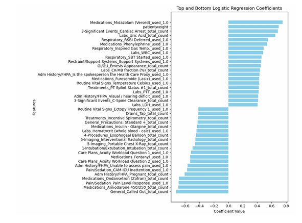
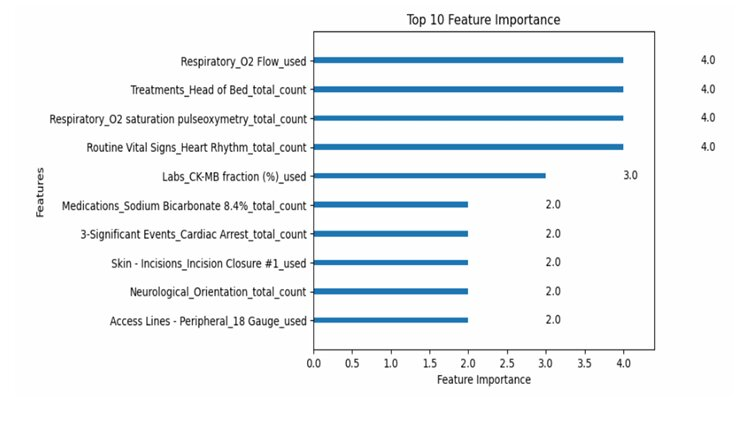

# Results and Interpretation — Full Report First

## Tuned Tabular Models: Detailed Full-Report Experiments

| Model | Validation accuracy | Test accuracy |
| --- | ---: | ---: |
| XGBoost (grid-search tuned) | 0.8296 | 0.7743 |
| Logistic Regression (grid-search tuned) | 0.8359 | 0.7589 |

The detailed experiments appear on pp. 34–37 of the 50-page report. Its later final combined table reports different tabular numbers; these results are presented separately, not merged or silently overwritten. The classwise metrics in the detailed report should not be confused with the final table's aggregate precision/recall/F1.

## Combined Summary Table: Validation

| Model | Accuracy | Precision | Recall | F1 |
| --- | ---: | ---: | ---: | ---: |
| XGBoost | 0.7692 | 0.78 | 0.77 | 0.77 |
| Logistic Regression | 0.7282 | 0.74 | 0.73 | 0.72 |
| BERT | 0.9136 | 0.8878 | 0.9136 | 0.8904 |
| RoBERTa | 0.9128 | 0.8332 | 0.9128 | 0.8712 |

## Combined Summary Table: Test

| Model | Accuracy | Precision | Recall | F1 |
| --- | ---: | ---: | ---: | ---: |
| **XGBoost** | **0.7692** | **0.78** | **0.77** | **0.77** |
| Logistic Regression | 0.7282 | 0.74 | 0.73 | 0.72 |
| BERT | 0.7231 | 0.6566 | 0.7231 | 0.6566 |
| RoBERTa | 0.6769 | 0.4582 | 0.6769 | 0.5465 |

**The combined report table lists XGBoost with test F1 0.77.** The sequence models exhibited pronounced validation-to-test declines.

## Model Interpretation — Detailed Report Rankings

In the detailed full-report experiment (p. 38), the reported leading positive coefficients are **3-Significant Events_Cardiac Arrest_total_count**, **Medications_Midazolam (Versed)_used_1.0**, and **Labs_Uric Acid_total_count**. The retained image comes from the summary-version experiment and may show a different ranking.

In the detailed full-report experiment (p. 39), the reported top four features are **Respiratory_O2 Flow_used**, **Neurological_Orientation_total_count**, **Pain/Sedation_Pain Present_total_count**, and **Respiratory_O2 saturation pulseoxymetry_total_count**. The retained figure corresponds to the separate summary ranking.

Coefficients and feature importances are predictive associations, not evidence of clinical causation.

## Limitations and Future Work

- Quantitative variables such as medication dose and fluid balance were not fully incorporated.
- Earlier admissions and rare clinical events were not comprehensively represented.
- Sequence inputs did not use learned elapsed-time embeddings or numerical event values; BERT/RoBERTa had a 512-token limit.
- Learning rate and weight decay sweeps were limited in the sequence experiments.
- Training/validation patient overlap, admission-selection differences between methods, and a clinically meaningful observation cutoff need additional validation.

## Source Notes

The full 50-page report details tuned-grid-search XGBoost validation accuracy **0.8296** and test accuracy **0.7743**, plus Logistic Regression validation accuracy **0.8359** and test accuracy **0.7589** (pp. 34–37). The final combined result table in that same report (pp. 47–48), repeated in the 14-page summary (p. 10), instead lists XGBoost **0.7692** and Logistic Regression **0.7282** for both validation and test. The tables above reproduce the combined summary as printed, not independently verified split-specific results. The discrepancy is internal to the source reports; there is insufficient evidence to replace all reported results with a single reconciled set. The coefficient figure and explanatory paragraphs do not establish a single unambiguous feature ranking.

Earlier in-hospital mortality metrics are documented separately in [Earlier Analysis](earlier-analysis.md).
